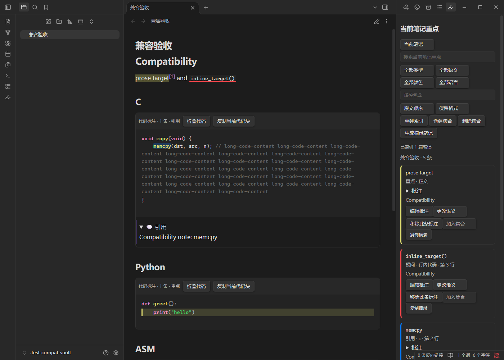

# Highlight Boost

Highlight prose, inline code and exact ranges inside code blocks. Add annotations, find related highlights across notes, and export excerpts with links to their sources.

[中文](README.md) · [User guide](docs/usage.md) · [Changelog](CHANGELOG.md)

**1.0.0 is being prepared for its first release.** Highlight Boost targets the latest stable Obsidian desktop version, currently **1.15.1**, on Windows, macOS and Linux. The community directory submission has been made; listing follows the official review.

## Features

- Native prose colors and four editable semantic presets: Important, Question, Reference and Action.
- Whole inline-code highlights, exact code selections and code-line highlights.
- Selection toolbar, commands and context menus, with multi-selection operations in one undo step.
- Annotations stored alongside your notes and included in search and excerpts.
- A workbench for the current note, a folder, the vault or a saved collection. Combine text, type, semantic, color, language and path filters.
- Source navigation, code context, excerpt copying and four excerpt-note templates. Pagination displays 50 results at a time; search and export include all matches.
- Host syntax highlighting or built-in Shiki in Reading view and Live Preview.
- Code titles, logical line numbers, wrapping, folding and diff-copy actions.
- Preview-based import from Highlightr, Hilo and fence line markers, with per-file restoration.
- Chinese and English UI, pop-out windows, keyboard navigation and styled PDF output.

## Install and use

After publication, download `main.js`, `manifest.json` and `styles.css` from the same [GitHub release](https://github.com/danlingdan/highlight-boost/releases). Place them in `.obsidian/plugins/highlight-boost/` inside your vault, then enable Highlight Boost in Community plugins. The installation ZIP also includes the plugin folder and license files.

Once listed, search for **Highlight Boost** in Obsidian Community plugins.

Select prose or code and choose a semantic preset in the selection toolbar. Use **Lines** for code-line highlights. Open **Note highlights** to navigate, annotate or copy a highlight. Open the **Highlight workbench** for vault queries, collections and excerpt notes.

UI language, presets, the toolbar and code display are configurable. Re-enable the plugin after switching the syntax provider.

## Storage and support

Prose colors use native Obsidian markup. Semantic and code metadata use hidden Markdown comments; prose annotations use footnotes. Code-block annotations sit outside the fence. See the [format reference](docs/formats/README.md).

Desktop support follows the latest stable Obsidian release. Mobile support is evaluated separately. The [stage G matrix](docs/verification/phase-g-matrix.md) documents the completed desktop validation and its exact scope. Release-specific review and manual installation checks are tracked on the [release preparation page](docs/releases/README.md).

## Credits

Special thanks to **Moritz Jung (mProjectsCode) and the Shiki Highlighter contributors**. Its theme mappings, display configuration and styles are incorporated into the built-in syntax module, maintained here with editor integration and lifecycle handling.

Thanks to **Pine Wu, Anthony Fu and the Shiki contributors**, and **Tibor Schiemann (hippotastic) and the Expressive Code contributors**. See [third-party notices and licenses](THIRD_PARTY_NOTICES.md).

## Development

Use Node.js 24 and pnpm 11.25.0. Run `pnpm install --frozen-lockfile`, then `pnpm check`. Local vaults, profiles and caches live in `.local/`; candidate packages live in `dist/`. See [development](docs/development.md), [project structure](docs/structure.md) and [contributing](CONTRIBUTING.md).

[Issues](https://github.com/danlingdan/highlight-boost/issues) · [MIT License](LICENSE)
