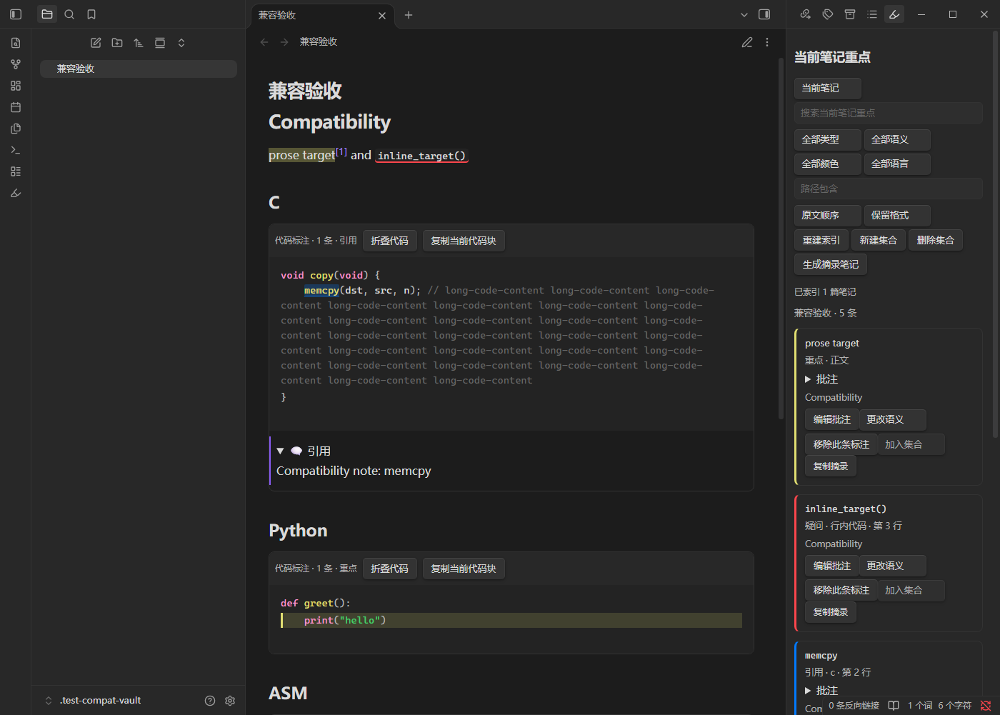

# Highlight Boost

把正文、行内代码和代码块中的重点放进同一个工作台：标记、批注、搜索，再生成带来源的摘录。

[English](README.en.md) · [使用说明](docs/usage.md) · [更新记录](CHANGELOG.md) · [文档导航](docs/README.md)

首发版本：**1.0.0**，发布准备中。面向最新 Obsidian 桌面稳定版，当前基线为 **1.15.1**。支持 Windows、macOS 和 Linux。

## 正文与代码，一起标注

- **正文**：局部改色，使用原生高亮颜色；四种语义预设为重点、疑问、引用、行动，可改名改色。
- **行内代码**：以整段为单位标注，保留内部反引号、`==` 和空白。
- **代码块**：标记整行或精确字符范围，叠加语法着色；支持重叠标注和重新定位。
- **编辑操作**：选区面板、命令、快捷键和右键菜单；多选区及跨正文 / 代码操作可一次撤销。
- **批注**：为三类对象添加说明，随笔记保存，并参与搜索和摘录。



## 从重点回到上下文

高亮工作台可查询当前笔记、目录、全库和集合。按类型、语义、颜色、代码语言及路径组合筛选；卡片显示标题链和代码上下文，点击即可选中来源。

复制单条摘录，或将完整查询结果生成摘录笔记。保留格式、纯文本、引用块和代码围栏四种模板均附带来源信息。大量结果每页显示 50 条，搜索与导出覆盖全部命中。

## 代码阅读与迁移

语法着色可选择 Obsidian 宿主或内置 Shiki。内置模式同时支持阅读视图和 Live Preview，并提供代码组件与复制操作。

代码展示支持标题、逻辑行号、起始行号、换行、折叠及 diff 复制。可读取 Code Styler、Codeblock Customizer、Hugo 和 Expressive Code 的通用围栏参数，见[参数对照](docs/formats/fence-parameters.md)。

导入工具支持 Highlightr、Hilo 和围栏行强调：先预览、选择文件，再应用；迁移记录可逐文件恢复。详见[迁移操作](docs/formats/migration.md)。

## 安装

`1.0.0` 的公开文档和发布日志正在核对。社区目录已提交，收录状态以官方审核为准。

正式发布后，从 [GitHub Releases](https://github.com/danlingdan/highlight-boost/releases) 下载同一版本的 `main.js`、`manifest.json` 和 `styles.css`，放入笔记库的 `.obsidian/plugins/highlight-boost/`，然后在“设置 → 第三方插件”中启用。ZIP 安装包也包含该插件目录及许可文件。

社区目录收录后，可在 Obsidian 第三方插件中搜索 **Highlight Boost** 安装。

## 快速上手

1. 在笔记中选中正文或代码，点击选区面板中的“重点”“疑问”“引用”或“行动”。
2. 标注代码整行时，将面板切换到“整行”，或执行“代码行”命令。
3. 打开“当前笔记重点”，点击卡片定位原文，展开批注或复制摘录。
4. 打开“高亮工作台”，切换目录 / 全库范围，筛选并生成摘录笔记。

设置中可切换中文 / English、调整语义预设、代码展示和选区面板。切换语法提供者后，重新启用插件。完整步骤见[桌面操作说明](docs/usage.md)。

## 笔记格式与支持范围

正文颜色使用 Obsidian 原生格式；语义、行内代码和代码块标注使用笔记中的隐藏注释，正文批注使用脚注。插件配置保存预设与集合。代码标注位于围栏外，代码内容保持原样，见[格式说明](docs/formats/README.md)。

当前支持桌面端，移动端支持另行规划。版本支持跟随最新 Obsidian 桌面稳定版；每次发布同步核验 manifest、SDK 与测试运行包。

阶段 G 已在 Obsidian 1.15.1 / Electron 43.8.9 完成三平台实际宿主验收，各 36 个场景、1112 项检查通过；扩展主题与插件矩阵为 120 个单元、970 项检查。环境、范围及原始结果见[验收矩阵](docs/verification/phase-g-matrix.md)。`1.0.0` 的文档审阅和下载安装检查记录在[发布准备页](docs/releases/README.md)。

## 特别感谢

特别感谢 **Moritz Jung（mProjectsCode）与 Shiki Highlighter 贡献者**。内置语法模块直接合入其主题映射、展示配置和样式，并在本项目维护编辑器接入与生命周期。

感谢 **Pine Wu、Anthony Fu 与 Shiki 贡献者**，以及 **Tibor Schiemann（hippotastic）与 Expressive Code 贡献者**。来源、改动和 MIT 许可见[第三方致谢](THIRD_PARTY_NOTICES.md)。

## 开发与反馈

使用 Node.js 24 与 pnpm 11.25.0：

```sh
pnpm install --frozen-lockfile
pnpm check
pnpm prepare:runtime
pnpm prepare:vault
```

本地测试库、宿主配置、下载缓存和分析产物统一放在 `.local/`；候选包放在 `dist/`。详见[开发说明](docs/development.md)和[项目目录](docs/structure.md)。

[报告问题](https://github.com/danlingdan/highlight-boost/issues) · [贡献说明](CONTRIBUTING.md) · [MIT License](LICENSE)
