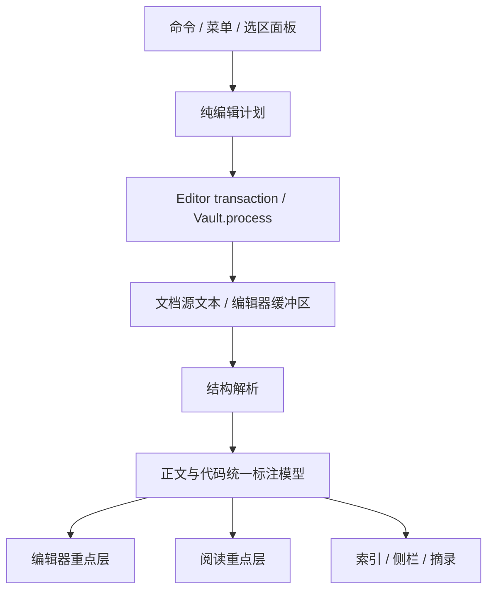

# 技术架构与数据设计

## 1. 技术栈

TypeScript、Obsidian 公共 API、CodeMirror 6、esbuild；侧栏采用 Obsidian DOM 与组件接口。原型阶段评估 Markdown 结构解析库，并用与宿主输出的差分样例决定最终选型。纯计算层使用 Vitest 与性质测试，宿主行为使用真实 Obsidian 测试库。

官方 sample-plugin 构建配置将 `obsidian`、CodeMirror 和 Lezer 模块设为 external，产出 CommonJS `main.js`。本项目沿用宿主依赖边界，锁定开发依赖及 lockfile。[官方示例](https://github.com/obsidianmd/obsidian-sample-plugin)

运行时使用当前 Web API 和 Vault API；开发构建脚本可以使用 Node。只支持最新 Obsidian 桌面稳定版，当前版本声明与测试运行包为 1.15.1。每次发布更新 `minAppVersion` 并在该稳定版验收，代码直接使用当前 API。

## 2. 模块结构

```text
src/
  main.ts                 生命周期、命令和事件注册
  domain/                 Highlight、CodeBlock、SemanticPreset、Anchor
  parsing/                文档结构、正文、围栏、代码元数据、格式适配
  editing/                纯变换、变更计划、选区映射、宿主事务
  rendering/
    editor/               CM6 重点装饰及状态
    reading/              Markdown 后处理和代码 DOM 适配
  indexing/               文件队列、局部更新、查询、缓存
  persistence/            配置、注释元数据、版本迁移
  anchors/                代码及正文重定位
  exporting/              摘录、纯代码、Markdown、格式适配
  ui/                     调色面板、侧栏、设置、批注
  integrations/           第三方渲染器及格式导入
  i18n/                   简体中文、英文
tests/
  fixtures/               Markdown、代码、历史格式样例
  unit/                   解析、编辑、锚定、导出
  integration/            DOM、事件、索引、宿主验证脚本
docs/verification/        每个阶段的验证结果与截图
```



## 3. 统一对象

下列为拟定类型，字段实现由阶段 A 的样例验证后定稿。

```ts
type TargetKind = 'prose' | 'inline-code' | 'code-line' | 'code-range';
type ColorKey = 'default' | 'red' | 'orange' | 'yellow' | 'green' | 'blue' | 'purple';

interface Highlight {
  id: string;                    // 持久记录使用独立 ID
  kind: TargetKind;
  path: string;
  semanticId?: string;
  color: ColorKey;
  source: { from: number; to: number }; // 当前快照中的 UTF-16 偏移
  quote: string;
  anchor: Anchor;
  commentRef?: string;
  format: 'native' | 'hb-v1' | 'legacy';
}

interface Anchor {
  blockId?: string;
  headingPath: string[];
  prefix: string;
  suffix: string;
  occurrence: number;
  contentHash: string;
  status: 'resolved' | 'ambiguous' | 'missing';
}
```

普通原生正文高亮由文本解析得到临时键；需要批注、集合或持久语义时赋予 ID。重建索引不会改变持久 ID。代码块的块 ID 与标注 ID 独立，多个标注可共享代码块。

偏移以 UTF-16 为准，与 JavaScript 和 CM6 一致；用户界面显示逻辑行及可读列。代码复制与哈希使用明确的换行策略，写入保留原文件换行风格。

## 4. 解析层

先识别 frontmatter、注释、段落、行内代码、围栏和嵌套容器，再调用各对象解析器。围栏状态包含字符种类、长度、容器前缀、语言、info string、闭合状态和内容源映射。

正文解析遵循宿主高亮行为；代码块解析保留代码原字符，只解释围栏外的 HB 元数据或明确导入的 fence 参数。代码内部 `==` 不产生正文条目。Markdown 语言代码块里的内嵌示例同样保持字面内容。

CM6 的语法树可辅助识别范围；具体节点名称和结构由宿主样例确认。离线索引与编辑器共用文档解析核心，使用宿主渲染结果做差分验证。正则用于局部字段识别，嵌套 Markdown、围栏和源映射交给结构解析层。

## 5. 编辑与撤销

所有动作先生成 `EditPlan`：输入文档版本、选区、语义；输出有序 replacements、更新后选区与标注变更。

- 活动文档：调用 `Editor.transaction()` 一次提交，保持光标、选区和原生撤销历史。
- CM6 直接接入：用于需要 ChangeSet 映射的装饰及代码锚点，适配层集中管理。
- 后台文档：使用 `Vault.process()`，在回调中基于当前文本重算变换。
- 调色面板开启期间文本可能继续变化：应用前按原锚点重定位，并向用户展示实际目标。
- 批量迁移逐文件记录结果及原始片段，提供对应恢复操作。

编辑一个代码标注时，同步更改其围栏外元数据；正文批注和标识通过相同事务写入。标注内容位于笔记文本中，使撤销与正文变更自然一致。

行内代码使用紧邻闭合反引号的 `%%hbi:...%%` 注释，保存整段代码的身份和语义快照。具体字段、显示值与源范围规则见 [inline-v1](../formats/inline-v1.md)。表格沿用宿主事务的异步提交，调用方在完成后读取源文本。

正文语义采用紧邻原生高亮的 `%%hbp:...%%` 注释，颜色从原生标记读取，语义与名称从注释读取。拆分和合并由同一纯编辑计划处理，完整字段见 [prose-v1](../formats/prose-v1.md)。

## 6. 渲染层

编辑器通过 `registerEditorExtension()` 注册。ViewPlugin 管理可见范围内装饰；StateField 管理需跨视口保持的状态与位置映射，按实际布局需求选择。行背景、文本底线和语义边条分别使用 line、mark、widget 装饰。

阅读视图通过 `registerMarkdownPostProcessor()` 接收渲染结果，结合 `ctx.sourcePath`、`getSectionInfo()` 及源文本映射定位。原生代码块语言入口由宿主处理，重点层增强既有输出；专用 `highlight-boost` 查询块才使用 `registerMarkdownCodeBlockProcessor()`。

阅读视图中同一代码文本可能被 Prism 拆成多个 token。适配器将源字符区间映射到文本节点，通过 Range 拆分/包装所需节点并保持 token 类。DOM 更新以对象 ID 标记，实现重复处理幂等；原型阶段检验跨行 token、末尾空行、Tab 和嵌套 span。

多窗口元素使用所属 document/window，事件通过组件生命周期注册；阅读子视图绑定 MarkdownRenderChild。卸载释放观察器、事件和样式资源。

## 7. 索引与更新

活动文档缓冲区是当前编辑内容的来源，磁盘索引服务其他文件。监听 create、modify、rename、delete，文件夹改名更新后代路径。缓存与扫描调度在功能完成后的统一性能阶段调整。

每个文件索引记录内容指纹、解析版本及条目列表。解析任务带版本号，采用最新结果。变更只替换该文件的条目；全库任务提供进度及暂停、继续操作。事件合并、任务批次与主线程调度在统一性能阶段按测量结果优化。

运行时按文件保存标注列表，并提供语义、类型和语言查询。缓存与用户内容分开：缓存可重建，批注及持久语义写入 Markdown。功能完成后统一测量查询、渲染和索引，再决定缓存与查询结构优化，见 [验证方案](07-验证与发布.md)。

## 8. 持久化、同步与路径

| 数据 | 存储位置 | 同步策略 |
| --- | --- | --- |
| 正文高亮 | 原生 Markdown | 随笔记同步 |
| 代码标注、持久 ID | 相邻 HB 注释 | 随笔记同步 |
| 批注 | 正文脚注或 HB 记录 | 随笔记同步 |
| 预设及设置 | 插件 `data.json` | 由 Obsidian 配置同步决定；提供 JSON 导入导出 |
| 集合 | 用户指定的 Markdown 清单 | 随笔记同步 |
| 索引缓存 | 插件缓存文件 | 每设备重建，版本不匹配即重算 |

配置使用 `loadData` / `saveData`，缓存写入串行队列；相对配置路径基于 `Vault.configDir` 与实际插件目录生成。用户路径使用 `normalizePath`。设置含 schemaVersion，并为每次升级提供迁移函数。

双设备并行改同一笔记时，以同步系统产生的文件内容为准；解析层识别重复 ID，按所属块和内容分配，提供重复记录整理入口。对于移动或复制整个代码块，元数据和代码一起移动，复制导致的 ID 重复在下一次显式编辑时生成新 ID。

## 9. 锚定与内容变化

代码块按 blockId 找到，再结合代码语言、标题路径和内容指纹确认。范围先使用行列提示，在代码块内核对 quote；插入前置行后，利用原句及前后上下文重新定位。重复代码通过 occurrence 和上下文区分。

编辑器内使用 ChangeSet 映射实时更新位置；持久元数据在用户执行标注操作时保存最新锚点。普通键入保持原生编辑事务，读取时用 quote 修正旧行列提示。文本发生实质改动时将条目标记为待重新定位，侧栏保留原摘录，用户选择新位置后更新。

跨重启定位、重复片段、语义颜色变更、路径重命名分别做验收。行号是位置提示，原句和上下文共同决定目标。
