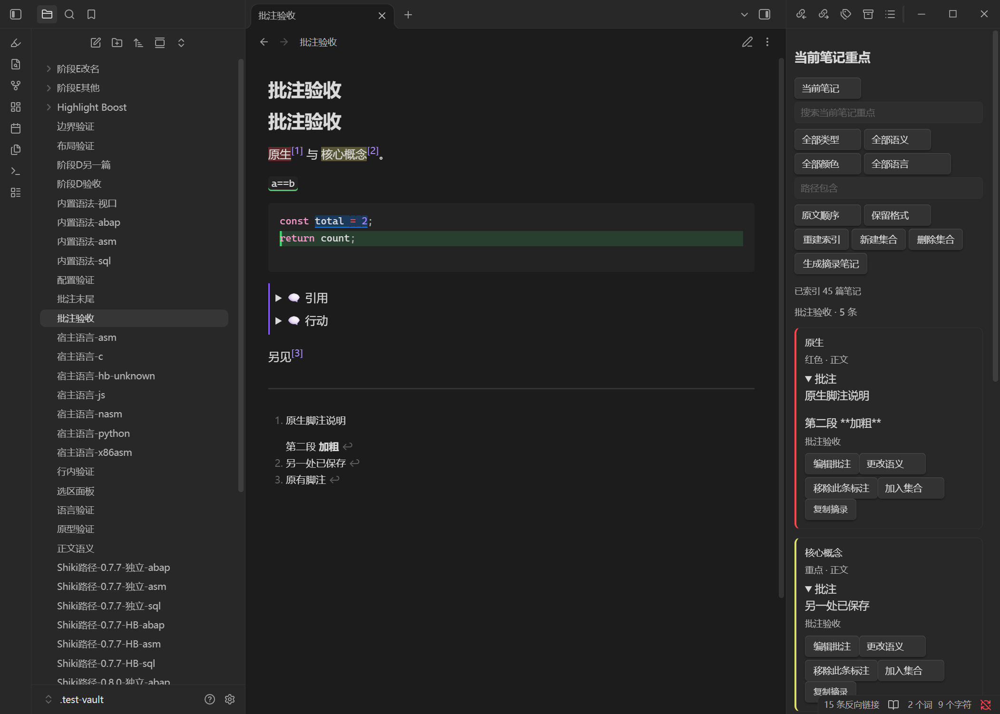
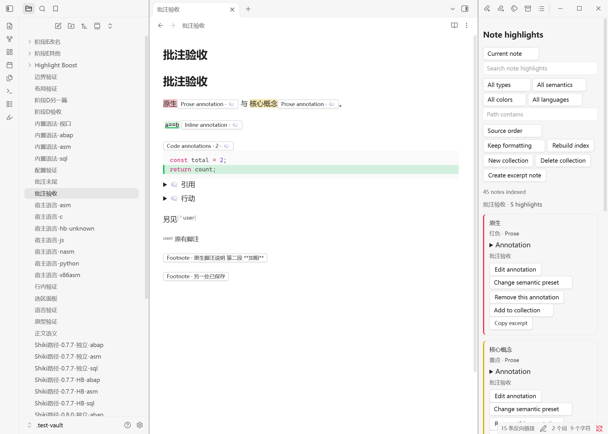

# 阶段 F：批注模块验证

日期：2026-11-14。环境：Windows、Obsidian 1.15.0 运行包、隔离 Electron 38.8.6、插件 0.1.0。

## 本轮交付

正文通过标准脚注保存说明，行内代码和围栏代码保存关联批注。侧栏支持多行编辑、保存、取消与展开；源文变化时保留草稿。改色、改语义、正文拆分和代码重新绑定均继承原说明。批注进入查询、集合快照和摘录笔记。

Live Preview 收起正文脚注引用及定义，避免显示内部 ID。阅读视图保留宿主脚注，代码组件将说明放在 `pre` 外，可以展开；纯代码复制不包含说明。中英文界面分别验证，深浅主题截图已查看。

## 覆盖矩阵

| 功能 | 验证内容 | 证据 |
| --- | --- | --- |
| 正文脚注 | 原生高亮获得身份、多行及 CRLF、实际阅读脚注 | `tests/notes.test.ts`、`notes-native-reading-footnotes` |
| 代码批注 | 行内、文本、整行及特殊字符，代码与复制文本不变 | `notes-code-source-exact`、`notes-code-copy-excludes-comments` |
| 修改和撤销 | 改色、局部拆分、共享脚注、清空、一次撤销与重做 | `tests/notes.test.ts`、宿主专项 |
| 冲突处理 | 已保存批注变化后，旧对话框保留草稿并提示刷新 | `notes-stale-dialog-retains-draft` |
| 锚点恢复 | 改写后保留说明，重新绑定继承批注 | `notes-rebind-keeps-comment` |
| 检索与复用 | 批注文本搜索、集合快照、实际生成摘录 | `notes-search-comment-text`、`notes-collection-snapshot`、`notes-export-note-comments` |
| 三视图 | Source 提示、LP 脚注折叠、阅读脚注、内置组件说明 | `tests/notes-folding.test.ts`、宿主专项 |
| 生命周期 | 重复渲染保留展开状态，卸载清理，独立进程恢复 | `tests/rendering.test.ts`、重启专项 |

## 结果

`pnpm check` 通过：lint、typecheck、24 个测试文件中的 140 项测试与构建。

完整二十条宿主场景通过后，批注专项以最终源码再次复核：批注 47 项、独立进程恢复 9 项。加上既有 456 项，当前共 512 项宿主检查通过。

- [批注专项](host-notes-results.json)
- [独立进程恢复](host-notes-restart-results.json)
- `pnpm test:notes` 运行两条批注场景；`pnpm test:host` 运行全部二十条场景。

专项页面错误收集为空。独立进程验证五条批注、重新绑定后的代码说明、正文定义、行内特殊字符、集合及导出恢复，并还原测试配置。

## 后续

阶段 F 的批注模块已完成。标题、行号、折叠设置、diff、第三方参数适配、Highlightr/Hilo 导入、迁移预览与逐文件恢复继续按阶段 F 推进。性能测试与优化统一在计划功能完成后的阶段 G 开展。
