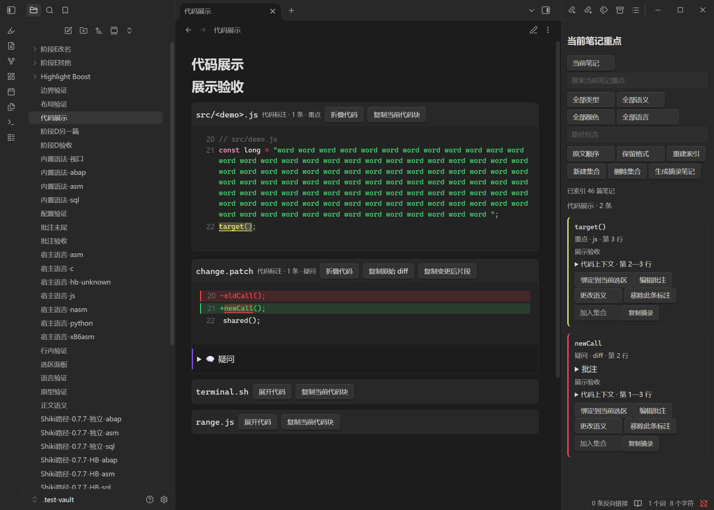
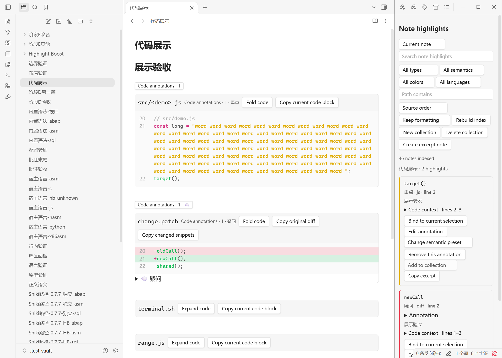

# 阶段 F：代码展示与 diff 验证

日期：2026-11-14。环境：Windows、Obsidian 1.15.0 运行包、隔离 Electron 38.8.6、插件 0.1.0。

## 本轮交付

统一代码标题栏、逻辑行号、起始编号、行号字体、长行换行与整块折叠。全局默认值和围栏覆盖即时生效。折叠摘要显示标注数量与语义，侧栏跳转展开对应组件和编辑器原生折叠。

diff 增删背景与人工标注、批注共存，原始前缀保留。提供原始补丁与变更片段两种复制。内置引擎保留首行文件名注释、shell 注释和复制数据。说明及样例见 [展示规则](../formats/code-display.md)。

## 覆盖矩阵

| 功能 | 验证内容 | 证据 |
| --- | --- | --- |
| 配置 | 实际开关、数字和字体控件，逐块覆盖，即时更新 | `display-settings-real-controls`、`display-settings-start-font`、`display-fence-overrides-line-default` |
| 行号与换行 | 空行、逻辑编号、长行几何尺寸，宿主和内置路径 | `tests/code-display.test.ts`、`display-logical-numbers`、`display-builtin-wrap` |
| 折叠和定位 | 默认收起、切换视图保持、原生折叠后的来源跳转 | `display-native-folded-jump-expands`、`display-fold-session-survives-view-switch` |
| diff | 简写、unified、多文件、hunk 内文件头形似内容 | `tests/code-options.test.ts`、`display-diff-and-human-mark-coexist` |
| 复制 | 折叠状态下原始 diff、变更片段、命令、文件和 shell 注释 | `display-copy-collapsed-diff-raw`、`display-copy-collapsed-diff-after`、`tests/syntax-engine.test.ts` |
| 局部折叠 | 读取嵌套代码行，排除折叠摘要，映射完整代码 | `tests/reading-mapping.test.ts`、`display-builtin-preview-components` |
| 生命周期 | 无标注组件重复刷新稳定、卸载还原、独立重启恢复默认折叠 | `tests/code-display.test.ts`、`display-unload-restores-native-dom`、重启专项 |
| 原文与批注 | 两种提供者及三视图操作后原文完全匹配，批注保存 | `display-all-paths-source-exact`、`display-restart-note-preserved` |

## 结果

`pnpm check` 通过 lint、typecheck、26 个文件中的 152 项测试及构建。`pnpm test:host` 的二十二条独立进程场景共 560 项检查通过，其中本模块新增展示 40 项、重启 8 项。专项页面错误收集为空。

- [展示专项结果](host-display-results.json)
- [独立重启结果](host-display-restart-results.json)
- `pnpm test:display` 单独运行这两条场景。

已查看以下两张截图，检查标题栏、换行、行号、diff 背景和批注布局：

阶段 F 的代码展示与 diff 模块完成。第三方参数适配、Highlightr/Hilo 导入、迁移预览与逐文件恢复继续推进。统一性能测试与优化安排在阶段 G。
