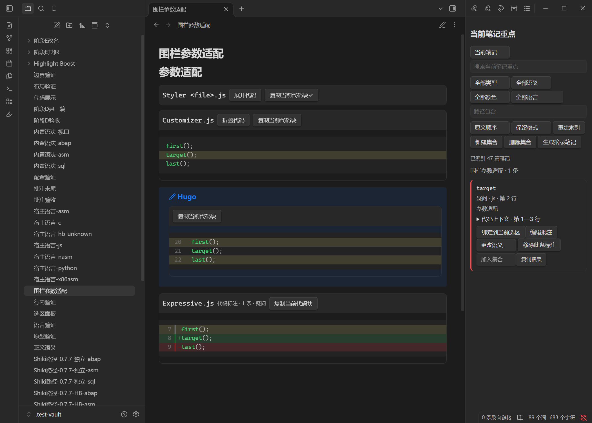

# 阶段 F：围栏参数适配验证

日期：2026-11-15。环境：Windows、Obsidian 1.15.0 运行包、隔离 Electron 38.8.6、插件 0.1.0。

## 本轮交付

Code Styler、Codeblock Customizer、Hugo 和 Expressive Code 的通用标题、行号、折叠与行强调参数接入 HB 展示层。解析区分引号、数组、范围和属性集合，支持参数别名和原生参数优先级。对照、示例和扩展字段见 [参数说明](../formats/fence-parameters.md)。

Live Preview callout 复用渲染 DOM 时，通过 CodeMirror 源位置建立独立展示子组件。组件拥有所属 callout 的渲染与清理，原阅读子组件跳过已接管的内容，避免重复拆装外框。相同代码出现在多个围栏时，按源区段匹配。

## 覆盖矩阵

| 能力 | 验证 | 证据 |
| --- | --- | --- |
| 参数解析 | 引号、转义、Hugo 数组/逗号/大小写、未知字段、不完整输入 | `tests/fence-params.test.ts` |
| 显示优先级 | 标题别名、原生参数覆盖、行号开启/关闭及起始值、fold/unfold | 单元测试、宿主 `parameter-number-offset` 等 |
| 行强调 | 多段范围、空行、文本、受限行文本、正则、带标签 EC 范围 | 单元测试、宿主 `parameter-restricted-text` |
| 原文与人工标注 | 参数强调叠加人工标注，代码和笔记逐字符匹配 | `parameter-manual-mark`、`parameter-source-exact` |
| 三视图与提供者 | Source 行背景、阅读外框、Shiki LP 组件 | `parameter-source-mark`、`parameter-four-components`、`shiki-parameter-live-components` |
| 嵌套 callout | 宿主和内置 LP 逻辑行号、Hugo 强调、相同代码定位 | `parameter-hugo-callout`、`parameter-live-callout` |
| 复制与清理 | 折叠时纯代码复制，参数变化清除旧行，卸载移除组件与所有权标记 | DOM 测试、`parameter-collapsed-copy`、`parameter-unload-clean` |

## 结果

`pnpm check` 通过 lint、typecheck、27 个测试文件中的 160 项测试和构建。

`pnpm test:host` 的二十三条独立宿主场景共 596 项检查通过。新增参数专项 36 项，页面错误收集为空，完成后还原进入场景前的插件配置。

- [参数宿主结果](host-parameters-results.json)
- `pnpm test:parameters` 单独运行本轮专项。

已查看截图中的标题、折叠、行号、callout、普通及增删行背景：

后续推进 Highlightr/Hilo 导入、迁移预览与逐文件恢复。参数转为持久语义标注、扩展字段的逐项处理进入同一迁移流程。性能测试与优化统一在阶段 G 开展。
