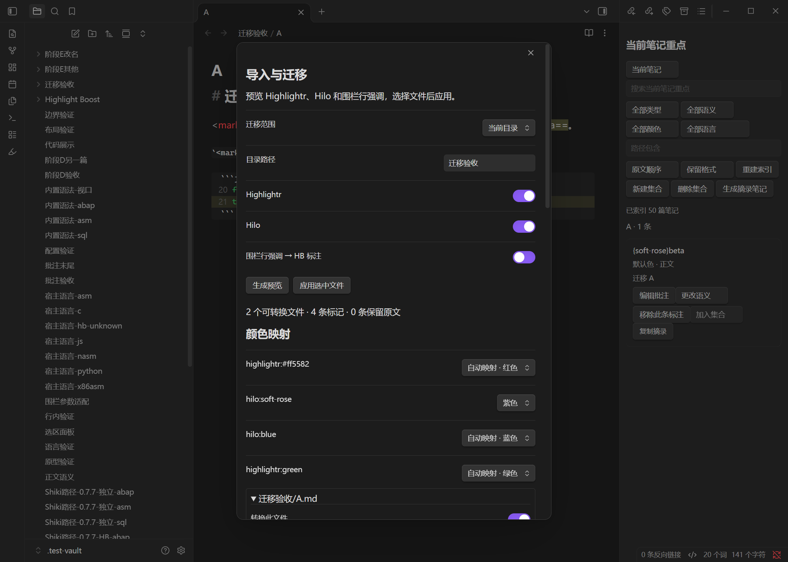

# 阶段 F：导入迁移与恢复验收

日期：2026-11-15。环境：Windows、Obsidian 1.15.0 运行包、隔离 Electron 38.8.6、插件 0.1.0。

## 本轮交付

Highlightr 内联颜色/CSS 类、Hilo 颜色 token 与围栏行强调可导入原生颜色及 HB 标注。窗口提供当前笔记、目录、全库范围，颜色映射、逐文件勾选和转换预览。选中文件摘要与实际应用数量对应。记录保存原文及转换后快照，支持逐文件恢复与重启后恢复。

## 覆盖矩阵

| 能力 | 验证内容 | 证据 |
| --- | --- | --- |
| 格式识别 | Highlightr HEX/RGB/类、大小写、实体、Hilo、Markdown 内联格式 | `tests/migration-plan.test.ts` |
| 来源区分 | 围栏、未闭合围栏、行内/缩进代码、YAML 和注释示例保留 | 同上 |
| 颜色映射 | 自定义色、主动保留、默认色别名、重建预览 | 单元测试、`migration-custom-color-mapping-control` |
| 代码导入 | 引用容器、CRLF、原参数保留、元数据独立、幂等 | 单元测试、`migration-index-prose-and-code` |
| 预览与应用 | 预览不写文件，映射变更使预览失效，取消文件选择，预览 4 条/实际 4 条 | `migration-preview-does-not-write`、`migration-selected-preview-count-four`、`migration-apply-count-four` |
| 部分执行 | 旧预览逐文件记录冲突，其余文件继续，已打开编辑器同步更新 | 服务测试、宿主专项 |
| 逐文件恢复 | 一次恢复一份文件，其他文件保持，新增编辑保留 | 服务测试、`migration-restore-one-file-exact`、`migration-restore-edited-file-unchanged` |
| 中断状态 | 先写快照、首次快照失败时不写笔记、状态保存失败后的恢复 | 服务测试、`migration-incomplete-state-keeps-snapshot` |
| 重启与语言 | 英文窗口、历史记录重载、重启后通过按钮恢复三个原文件 | 基础专项与独立进程专项 |

## 结果

`pnpm check` 通过 lint、typecheck、29 个测试文件中的 174 项测试和构建。

宿主矩阵为二十五条独立进程场景，共 635 项检查。本轮新增迁移 30 项、独立重启 9 项，页面错误收集为空；测试结束还原插件配置及三个迁移样例原文。

组合回归曾在显示场景捕获宿主 `ResizeObserver loop completed with undelivered notifications`。同一构建分别复核显示及重启、围栏参数、迁移及重启场景，最终结果均通过；该布局通知继续纳入阶段 G 的兼容矩阵。

- [迁移结果](host-migration-results.json)
- [独立重启结果](host-migration-restart-results.json)
- `pnpm test:migration` 运行本轮两条场景；`pnpm test:host` 运行全部二十五条场景。

已查看迁移预览截图，核对颜色映射、文件选择、计数和代码行说明：

## 阶段 F 覆盖

| 计划模块 | 状态与证据 |
| --- | --- |
| 正文脚注、代码批注及导出 | 已完成：[批注验收](annotations.md) |
| 标题、逻辑行号、字体、换行、折叠及来源跳转 | 已完成：[代码展示](code-display.md) |
| diff 与两种复制 | 已完成：[代码展示](code-display.md) |
| Code Styler / Customizer / Hugo / Expressive Code 通用参数 | 已完成：[参数适配](fence-parameters.md) |
| Highlightr / Hilo、预览、重复执行与逐文件恢复 | 已完成：本记录 |

阶段 F 完成，进入阶段 G：桌面兼容矩阵、统一性能测试与优化、发布候选验收。
