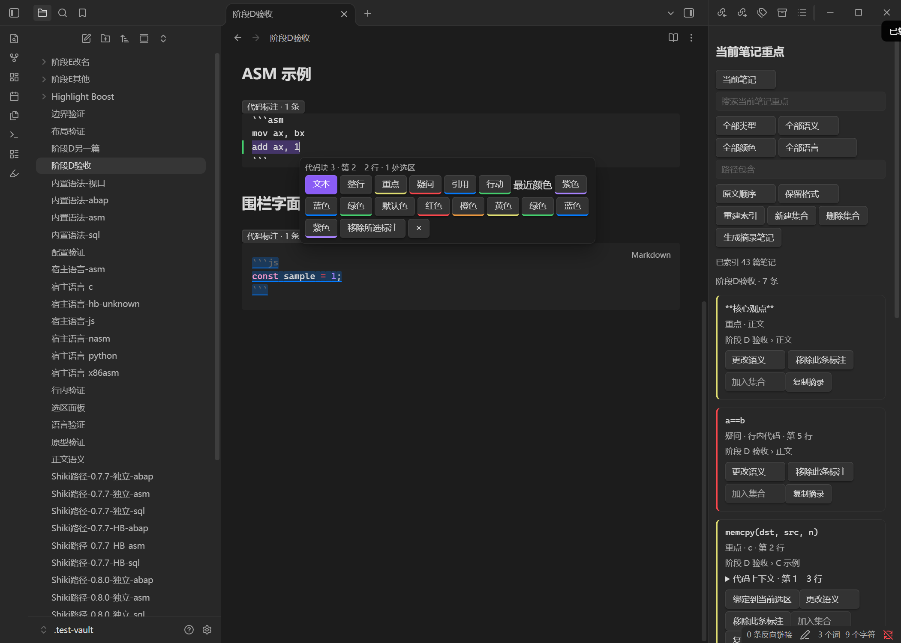
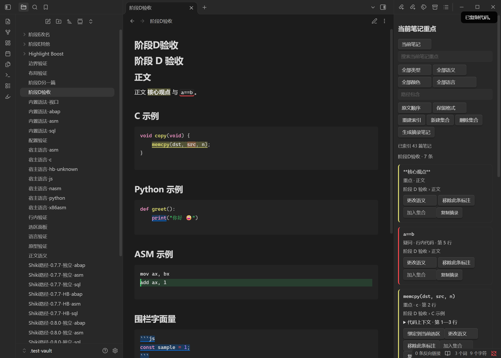

# 阶段 D：首个可用版本验收

日期：2026-11-14。原型 0.1.0。环境：Windows、Obsidian 1.15.0 运行包、隔离 Electron 38.8.6。

## 结论与交付

阶段 D 的 P0 闭环完成：正文、行内代码、C / Python / ASM 代码块可在同一笔记中标记、改色、移除、撤销、跳转及摘录，独立进程恢复后保留全部条目。桌面操作说明和 v1 格式说明已归档。

本轮补齐三项行为：摘录根据内容选择足够长的代码围栏；提供标题链、来源标题或已有块链接及相邻代码上下文；从阅读视图的侧栏跳转时进入 Live Preview 并选中源范围。卡片操作同时核对来源文件，旧卡片不会修改后来在同一编辑器打开的另一篇笔记。

## P0 覆盖矩阵

| 需求 | 已验收行为 | 证据 |
| --- | --- | --- |
| P01 正文颜色 | 默认色、六色、移除与 inline Markdown 保留 | [基础场景](host-results.json)、[正文场景](host-prose-results.json) |
| P02 精确编辑 | 局部拆分、多选区、跨正文与代码的一次事务及撤销 | [多选区场景](host-advanced-results.json)、`tests/mixed-selection.test.ts` |
| P03 代码行 | 单行、连续行、分离多选区、空行及逻辑范围 | [多选区场景](host-advanced-results.json)、[选区面板](host-selection-results.json) |
| P04 精确代码 | 精确字符、重叠身份、代码原文及单条编辑 | [阶段 D 场景](host-phase-d-results.json)、`tests/item-editing.test.ts` |
| P05 语法协作 | 原生 token、内置组件和 HB 重点层共存 | [语言矩阵](host-languages-results.json)、[内置场景](host-embedded-results.json)、[布局场景](host-layout-results.json) |
| P06 共享语义 | 三类对象共用名称、颜色、默认预设及快照 | [设置场景](host-settings-results.json)、[正文](host-prose-results.json)、[行内](host-inline-results.json) |
| P07 侧栏定位 | 三类对象、标题链、代码上下文、三视图精确跳转 | [阶段 D 场景](host-phase-d-results.json)、[选区侧栏](host-selection-results.json) |
| P08 复制摘录 | 纯代码、精确摘录、来源链接、行号、上下文及动态围栏 | [阶段 D 场景](host-phase-d-results.json)、`tests/excerpts.test.ts` |
| P09 桌面入口 | 命令、实际右键菜单、面板鼠标及键盘操作 | [阶段 D 场景](host-phase-d-results.json)、[选区面板](host-selection-results.json) |

统一场景由项目测试库构造，包含正文粗体、含 `==` 的行内代码、Tab、中文及 emoji、三种代码语言和内嵌反引号围栏。Source、Live Preview 和阅读视图逐项检查渲染及跳转；阅读模式的每一次跳转都从阅读状态重新开始。标注原文逐字符核对，并在新进程中恢复七条记录。

## 测试结果

`pnpm check` 通过：lint、typecheck、19 个测试文件的 116 项测试和构建。

宿主共十六个独立进程、405 项检查：既有 351 项，本轮统一场景 43 项，独立进程恢复 11 项。运行入口为 `pnpm test:phase-d`，完整回归为 `pnpm test:host`。结果分别见 [统一场景](host-phase-d-results.json) 和 [重启场景](host-phase-d-restart-results.json)。

Windows 当前宿主的功能证据在本轮归档。最低支持版本、其他桌面平台、第三方主题、多窗口和系统输入法矩阵继续在阶段 G 验收。既有语言场景的控制台 `Uncaught illegal access` 仍记录在 [中英文验证](i18n.md)；新增统一场景的页面错误收集为空。

## 画面与格式

以下画面通过隔离宿主 Electron 截图接口生成，检查阅读输出、Live Preview 元数据、语法与人工重点、侧栏标题链和展开的代码上下文。

当前首版写入格式冻结为 [正文 v1](../formats/prose-v1.md)、[行内 v1](../formats/inline-v1.md) 和 [代码 v1](../formats/code-v1.md)，统一说明见 [格式索引](../formats/README.md)。使用方法见 [桌面操作说明](../usage.md)。

## 下一阶段

阶段 E 接入全库增量索引、目录范围、组合过滤、集合及摘录笔记。批注、迁移和代码展示设置按阶段 F 继续；统一性能测试和优化仍在计划功能完成后的阶段 G 开展。当前交付源码和内部可用构建，Release 与社区上架在阶段 H。
