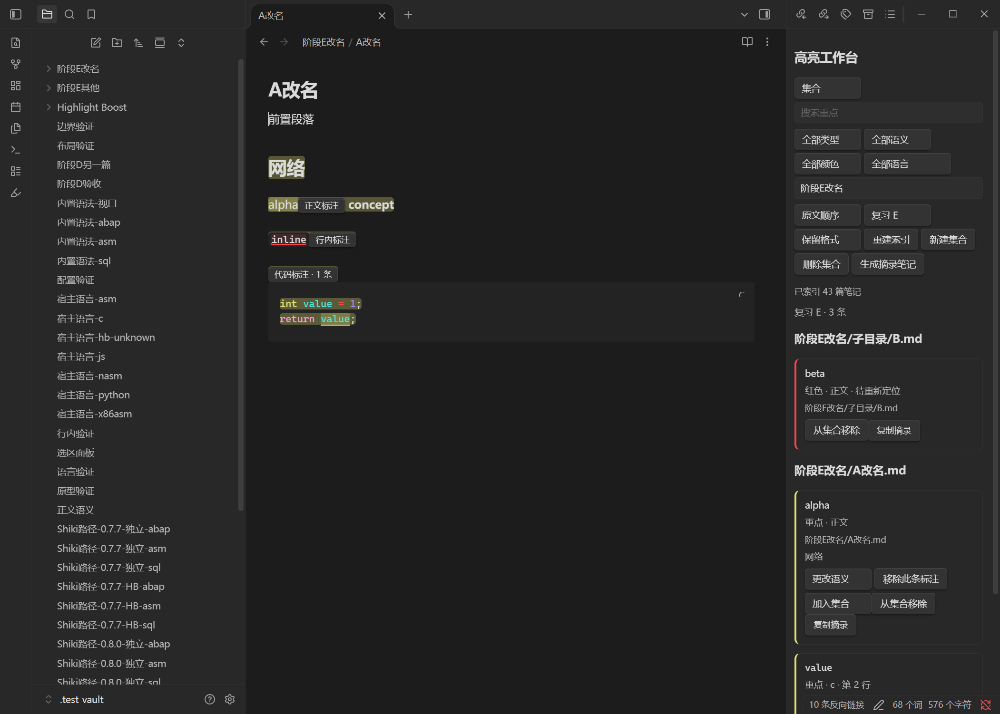
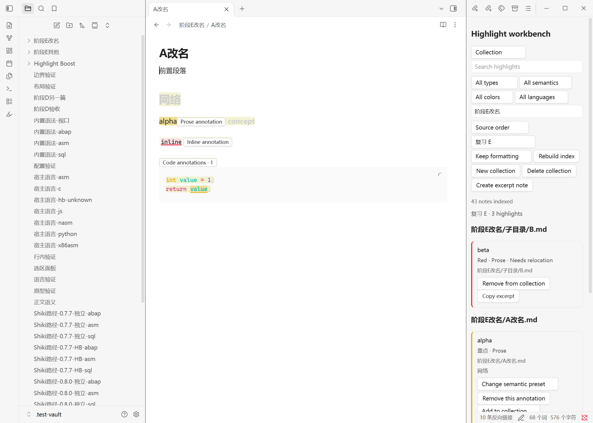

# 阶段 E：全库检索、集合与摘录

验证日期：2026-11-14。Windows、Obsidian 1.15.0 运行包、隔离 Electron 38.8.6，插件 0.1.0。

## 交付与行为

阶段 E 已接入统一高亮工作台：当前笔记、当前目录及子目录、全库和集合四种范围，正文与代码共用搜索结果。类型、语义、颜色、代码语言和路径可组合筛选；搜索匹配原文、语义名称和语言。结果支持按来源或语义排序分组。

索引在内存中保存每篇 Markdown 的文本与条目，从源笔记重建。创建、修改、删除和改名按对应路径更新；编辑器未保存缓冲区参与索引及查询。读取请求带版本号，旧结果不会覆盖更新的缓冲区、已删除路径或新路径。读取失败保留上次快照，工作台显示失败文件数，可通过重建重试。卸载后结束结果发布。

集合保存独立条目引用及加入时快照，重复加入同一条目会合并。持久标注按身份关联，普通原生高亮结合原句和上下文关联。能定位时显示当前条目；原文缺失或文件删除后保留加入时摘录及待定位状态。文件和目录改名会同步更新引用路径。移除集合条目或删除集合均保持源笔记原样。

摘录提供保留格式、纯文本、引用块和代码围栏四种模板。生成笔记包含来源链接、语义、标题链、代码行号及相邻行上下文；代码及引用块中的反引号围栏、HTML 字面值保持代码含义。笔记写入 `Highlight Boost/`，带 `highlight-boost-export: true` frontmatter，索引和打开的编辑器查询均排除此类导出，避免摘录再次进入结果。

工作台每个实例保存自己的范围及筛选状态。“打开当前笔记重点”和“高亮工作台”命令打开指定范围并重置检索条件；通过范围下拉框切换时保留条件。

## 验收矩阵

| 阶段要求 | 验证内容 | 证据 |
| --- | --- | --- |
| 增量队列及缓存 | 修改只读取对应文件，其他笔记缓存不变；旧读取不覆盖缓冲区 | `tests/vault-index.test.ts`，`e-buffer-update-keeps-other-note-cache` |
| 目录及全库范围 | 包含子目录，区分相似目录前缀，三类对象同屏检索 | `tests/query.test.ts`，`e-vault-unified-six-results`、`e-folder-includes-descendants` |
| 独立组合过滤 | 类型、语义、颜色、语言、路径、搜索及空状态 | `e-combined-filters`、`e-combined-empty-state` |
| 集合清单 | 实际弹窗创建、加入去重、跨类型、缺失快照、移除及删除 | `tests/collections.test.ts`，专项及重启场景 |
| 改名与删除 | 文件、目录和 Markdown 扩展名变化，集合路径及结果同步 | `e-file-rename-removes-old-key`、`e-folder-rename-updates-all-entries`、`e-non-markdown-rename-leaves-index` |
| 可重建索引 | 同组源笔记的增量结果与重建结果逐对象相等 | `e-rebuild-equals-incremental` |
| 模板及生成笔记 | 四种模板、实际文件创建、源文保持、导出排除 | `tests/excerpts.test.ts`，`e-export-note-created`、`e-export-not-reindexed` |
| 来源追溯 | 改名后链接解析到新路径，并实际打开源笔记 | `e-export-link-resolves-renamed-source`、`e-export-link-opens-source` |
| 新进程恢复 | 集合和路径恢复、源文相等、缺失状态、导出排除及配置恢复 | 独立进程 10 项检查 |

## 结果

`pnpm check` 通过：lint、typecheck、22 个测试文件中的 127 项测试及构建。完整十八场景运行后，阶段 E 专项补充扩展名改名和命令状态检查并再次运行，两条新增场景共 51 项通过；当前全部宿主结果共 456 项通过。

- [阶段 E 专项：41 项](host-phase-e-results.json)
- [独立进程恢复：10 项](host-phase-e-restart-results.json)
- `pnpm test:phase-e` 运行本阶段两条场景；`pnpm test:host` 运行全部十八条场景。

两条新增场景的错误列表为空，专项页面错误收集为空。快速将 C.md 改为 C.txt 再改回的运行中，宿主控制台曾输出旧 C.md 路径的 ENOENT；两次改名后的索引断言和最终读取均通过。此观察与既有语言场景控制台信息一并在阶段 G 宿主兼容矩阵跟踪。

截图通过 Electron 抓取项目测试库，已查看中英文、深浅主题的范围、筛选、模板、集合及缺失快照布局。

## 下一阶段

阶段 F 接入正文脚注、代码批注、展示设置、diff 和外部格式导入迁移。当前笔记 v1 格式保持不变，集合配置见 [集合引用说明](../formats/collections.md)。桌面操作见 [使用说明](../usage.md)。统一性能测试和优化在计划功能完成后的阶段 G 开展。
