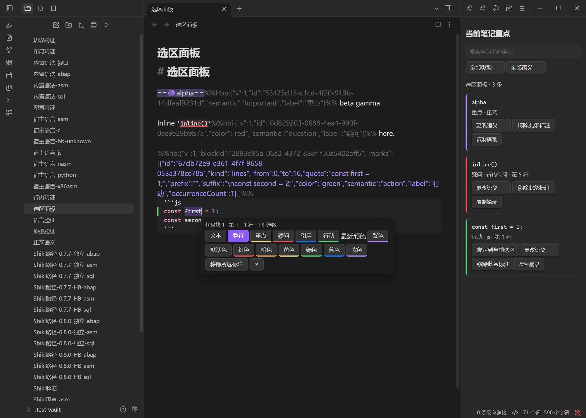
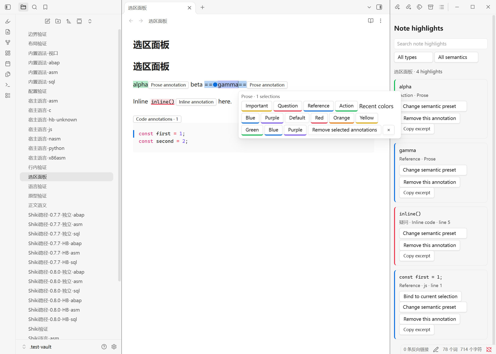

# 桌面选区面板与侧栏交互

验证日期：2026-11-14。Obsidian 1.15.0，隔离 Electron 38.8.6。

## 本轮交付

选区面板在 Source 和 Live Preview 中提供四种语义、原生七种颜色、最近三种颜色及移除。代码可切换文本和整行模式，标题显示块序号、逻辑行范围及选区数量。混合内容和多选区共用现有编辑计划及一次事务；连续操作保留逻辑选区，直接改色保留已有语义。

自动显示默认开启，也可关闭后用命令手动打开。方向键、Home/End 导航按钮，Enter 执行动作，Escape 关闭并返回编辑器。点击外部关闭，组合输入期间隐藏；切换阅读视图和卸载插件会清理面板。位置随所属编辑器的滚动与窗口尺寸变化更新，元素和监听器使用所属 document。

当前笔记侧栏增加搜索、类型和语义组合筛选、结果计数和无匹配提示。搜索控件保持原身份，刷新时保留筛选条件。三类对象均可逐条改语义、移除和撤销。代码按标注 ID 修改围栏外元数据，保留重叠标注及代码内容；原内容或语义变化后，旧卡片会提示刷新。

配置沿用 schemaVersion 2，增加 `selectionToolbar` 和 `recentColors`。最近颜色去重并保留三种，恢复默认语义预设保留其他设置。

## 验证覆盖

`pnpm check` 通过：lint、类型检查、18 个测试文件中的 106 项测试及构建。新增纯测试覆盖对象上下文、代码逻辑行、空代码行、多选区、配置规范化、逐条修改、重叠标注隔离、选择范围映射及旧卡片识别。

完整十四个宿主场景通过 351 项检查：既有 294 项，加本轮 [57 项专项检查](host-selection-results.json)。专项覆盖 Source 和 Live Preview、正文 / 行内 / 代码标注、整行改色、语义保留、多选区单步撤销、键盘导航、手动入口、外部关闭、双语、组合输入、侧栏组合筛选、单条修改和移除、配置重载及卸载清理。新增专项的页面错误收集为空；既有语言场景控制台信息继续见 [中英文记录](i18n.md)。

深浅主题截图通过 Electron [`webContents.capturePage`](https://www.electronjs.org/docs/latest/api/web-contents#contentscapturepagerect-opts) 抓取隔离测试库，等待隐藏宿主绘制后归档。已查看两张画面，核对面板按钮、选中模式、侧栏卡片及中英文布局。

## 后续阶段

下一项为阶段 D 逐项核对、操作说明及原型格式冻结收尾，再进入阶段 E 全库检索与摘录。本轮截图覆盖选区和侧栏，其他原型截图继续按清单归档。桌面系统和主题兼容矩阵、统一性能测试及优化在阶段 G 开展。
